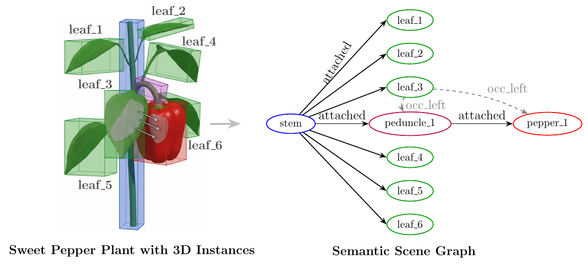
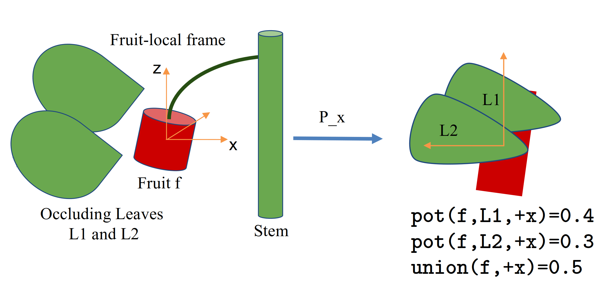
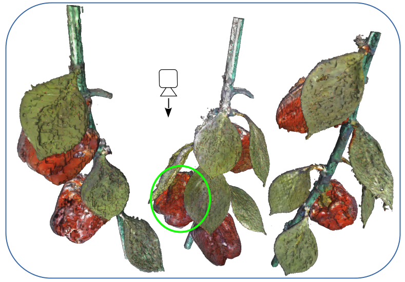
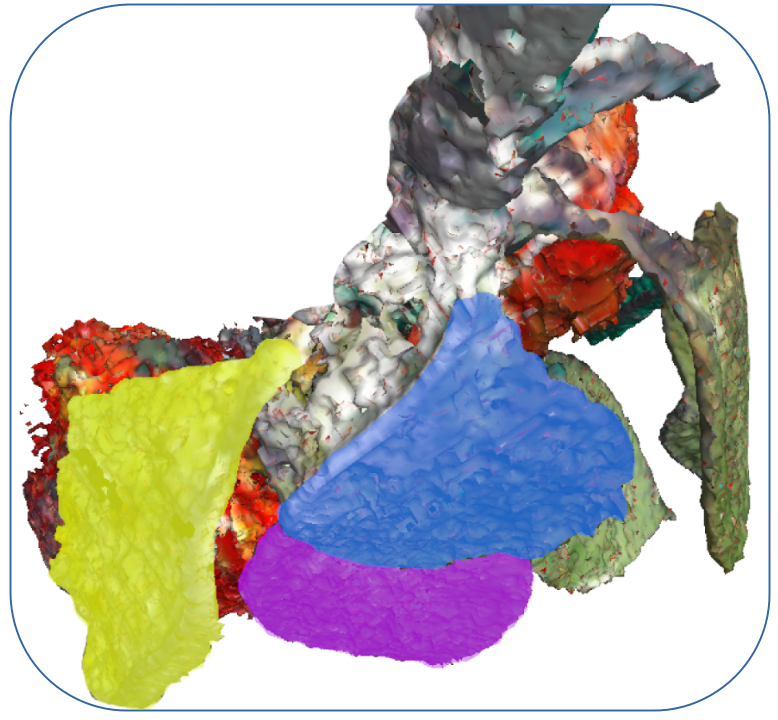

# SG-DOR: Scene Graphs with Direction-Conditioned Occlusion Reasoning



This repository contains the official implementation of the paper **SG-DOR: Learning Scene Graphs with Direction-Conditioned Occlusion Reasoning for Pepper Plants** (accepted at IEEE/RSJ IROS 2026).

SG-DOR trains a joint node/edge scene graph model on pepper plant geometry. It exposes clean configuration dataclasses, reusable transforms, a backbone registry, and training/evaluation helpers.

## Installation & Environment

This project relies on PyTorch, PyG (PyTorch Geometric), Open3D, WandB, and BlenderProc. A Conda environment configuration is provided in `environment.yml`.

To create and activate the environment:

```bash
conda env create -f environment.yml
conda activate bproc
```

## Dataset

The MIT-licensed SG-DOR training dataset is hosted on Hugging Face:
[rohit-hrl/sg-dor-dataset](https://huggingface.co/datasets/rohit-hrl/sg-dor-dataset).
It provides a graph-only configuration for graph machine learning and full
scene archives containing 4 mm point clouds, scene graphs, and directional
occlusion targets. The dataset repository is currently access-controlled.

## Getting Started

1. Set up the Conda environment as shown above.
2. Prepare your dataset in the same JSON format used by `datasets/processed/.../scene_graphs.json`.
3. Run training:

   ```bash
   python -m pepper_scene_graphs.main \
     --dataset-path /path/to/scene_graphs.json \
     --runs-root training \
     --param lr=0.001 \
     --param bs=64 \
     --wandb
   ```

   The CLI automatically builds run names like `20260130_123045_lr0p001_bs64`.
4. The training run will emit `config.json`, `best_model.pt`, `confusion_best.npz`, `preds_best.json`, etc.

## Configuration

- `pepper_scene_graphs/configs/config.py` defines dataclasses for training, data augmentation, loss/evidence weighting, logging, and modeling.
- Use `--param alias=value` to override specific fields (`lr`, `bs`, `epochs`, `drop`, `hd`, `layers`, `k`).
- CLI defaults now use the `pepper_scene_graphs` WandB project and structured run names.

## Evaluation

- Run `python -m pepper_scene_graphs.main --eval-only --checkpoint-path training/<run>/best_model.pt --wandb` to regenerate metrics, pred dumps, and optionally log to WandB.
- Evaluation artifacts are stored in `training/<run>/eval/`.

## Semantic Segmentation Training

The project now supports high-fidelity semantic segmentation for plant organs using PointNet++.

- **Data**: Procedural scenes voxelized at 2mm for high point density (~1M points/scene).
- **Labels**: Stem (1), Leaf (2), Peduncle (3), Fruit (4), Shoot (5). Note that `PepperPointDataset` supports merging Shoots into Leaves for a simplified 4-class model.
- **Color**: Biologically accurate RGB ranges are integrated with "weak-signal" dynamic augmentation (heavy jitter/dropout) to ensure geometric robustness.
- **Training**:

  ```bash
  python pepper_scene_graphs/training/train_semseg.py
  ```

- **Monitoring**: Full integration with WandB for loss curves and confusion matrices.

## Oracle Joint Model Training

The project includes an **Oracle Joint Model** that trains directly on point clouds and subgraphs to predict node classification, edge structures, and leaf-fruit occlusion.



- **Data**: Procedural scene graphs (`_graph.json`) and z-buffer occlusion sidecars (`_occl_zbuf_k3_*.npz`).
- **Training**:

  ```bash
  python scripts/train_oracle.py \
    --data_root /path/to/dataset \
    --runs_root training/oracle \
    --batch_size 32 \
    --lr 0.001 \
    --epochs 100
  ```

- **Configuration**: `scripts/train_oracle.py` exposes extensive command-line parameters (including Evidential Deep Learning flags, occlusion sampling, and curriculum learning). A full snapshot of all configurable arguments and their defaults has been documented in `oracle_config.yaml`.

## Oracle Ablation Experiments

To seamlessly run predefined experiments, the ablation suite automates W&B tagging, flag overwrites, and GPU memory checks:

```bash
python scripts/ablations/launch_oracle_ablation.py --key A0 --key L1 --gpu 0
```

This requires `scripts/ablations/oracle_ablations.json` containing the definitions.

## Qualitative Real-World Evaluation

Despite being trained on synthetic data, SG-DOR generalizes zero-shot to real-world reconstructions. Below is a qualitative evaluation showing the target fruit (green) and the primary occluding leaves successfully identified and ranked by the model:

| (a) Target Fruit surrounded by foliage | (b) Identified and ranked occluding leaves (Yellow, Purple, Blue) |
| :---: | :---: |
|  |  |

## Tools & Utilities

The project includes several utilities under the `scripts/` directory for dataset generation, model analysis, and inference:

### 1. Dataset Generation (`scripts/dataset_generation/`)

- **`scene_generation_obb.py`**: Generates procedural pepper plant scenes in Blender (using BlenderProc) with oriented bounding boxes, instance segmentation labels, and directional occlusion targets.
- **`run_chunked_generation.py`**: Runs procedural generation in parallel chunks to speed up data collection.
- **`postprocess_pointcloud_occlusion_zbuffer.py`**: Extracts and compresses camera/z-buffer-based occlusion targets from generated point clouds and scene graphs.
- **`verify_industrial_output.py`**: Audits and verifies the integrity of generated industrial datasets.

### 2. Analysis & Utilities (`scripts/analysis/`)

- **`update_dataset_colors.py`**: Applies realistic biological color ranges (with HSV jitter and grey-scale dropout) to the generated dataset files to test model robustness under weak color signals.
- **`verify_instance_segmentation.py`**: Audits instance clustering and evaluates IoU, F1, and mAP metrics.
- **`train_watchdog.py`**: Monitors semantic segmentation runs and dynamically restarts/tunes configurations if early geometric performance is poor.

### 3. Inference & Execution (`scripts/inference/` and `scripts/real_data/`)

- **`full_scene_inference.py`**: Performs block-wise tiling inference over dense 3D point clouds (up to millions of points) to evaluate full scene reconstructions.
- **`infer_oracle_real_scene.py`**: Runs the trained Oracle Joint Model on real-world sensor point clouds to construct scene graphs.

## License

This project is licensed under the MIT License - see the [LICENSE](LICENSE) file for details.

## Citation

If you find this work useful in your research, please cite our paper:

```bibtex
@inproceedings{menon2026sgdor,
  title={{SG-DOR}: Learning Scene Graphs with Direction-Conditioned Occlusion Reasoning for Pepper Plants},
  author={Menon, Rohit and Mueller-Goldingen, Niklas and Pan, Sicong and Chenchani, Gokul Krishna and Bennewitz, Maren},
  booktitle={Proceedings of the IEEE/RSJ International Conference on Intelligent Robots and Systems (IROS)},
  year={2026},
  note={Accepted}
}
```

Or the arXiv preprint:

```bibtex
@article{menon2026sgdor_arxiv,
  title={{SG-DOR}: Learning Scene Graphs with Direction-Conditioned Occlusion Reasoning for Pepper Plants},
  author={Menon, Rohit and Mueller-Goldingen, Niklas and Pan, Sicong and Chenchani, Gokul Krishna and Bennewitz, Maren},
  journal={arXiv preprint arXiv:2603.06512},
  year={2026}
}
```
